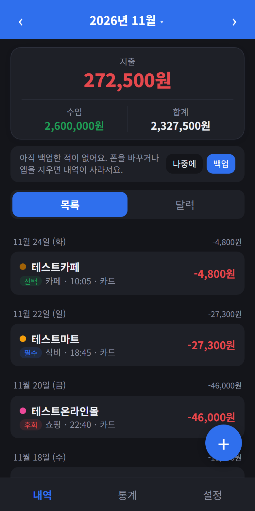
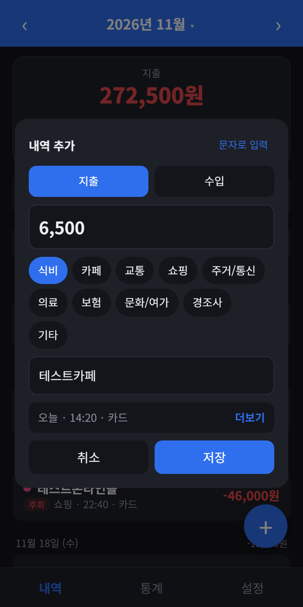
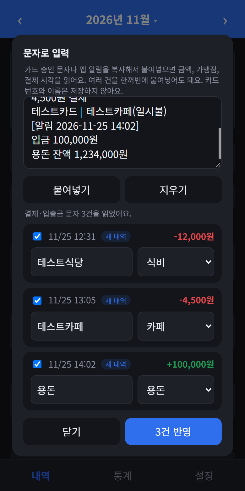
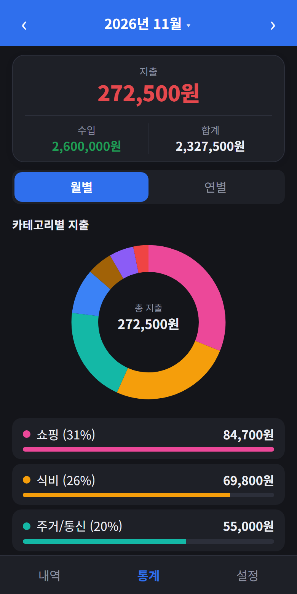

# 가계부

광고 없이, 내 폰 안에서만 쓰는 단순한 개인 가계부예요. 서버도 로그인도 없고, 데이터는 기기의 브라우저 저장소(`localStorage`)에만 저장돼요.

HTML, CSS, JavaScript만으로 만들었고 빌드 과정이 없어요. 모바일 화면에 맞춰져 있고, PWA로 홈 화면에 설치할 수 있어요.

## 화면

<p>
  
  
  
  
</p>

화면 속 내역은 모두 설명용 가짜 데이터예요.

## 기능

- **내역**: 지출·수입 추가, 수정, 삭제. 목록과 달력 보기, 월 이동. 달력은 토요일은 파랑, 일요일과 공휴일(대체공휴일 포함)은 빨강으로 표시하고, 임시공휴일·선거일은 알려진 날짜만 반영해요
- **통계**: 카테고리별 원그래프(눌러서 상세 확인), 월별·연별 보기, 결제수단별·소비 성격별(필수·선택·후회) 지출
- **카드 결제일**: 결제일과 사용 기간(예: 전달 19일~당월 18일)을 설정하면 다음 출금 예정액과 D-day를 보여줘요
- **고정지출·구독**: 매달 정해진 날짜에 자동으로 내역에 추가. 구독은 따로 모아서 보여줘요
- **문자로 입력**: 카드 승인 문자나 앱 알림을 붙여넣으면 금액, 가맹점, 결제 시각을 읽어요. 여러 건 한꺼번에, 취소·중복 문자도 알아서 처리해요. 카드번호와 이름은 저장하지 않아요
- **캘린더 알림**: 카드 출금일, 고정지출 일정을 `.ics` 파일로 내려받아 캘린더 앱에 추가
- **데이터 관리**: CSV 내보내기, JSON 백업과 불러오기

## 사용 방법

브라우저에서 `index.html`을 열면 돼요. 파일을 직접 여는 방식은 서비스 워커와 설치 기능이 동작하지 않으니, 정적 서버로 열거나 호스팅해서 쓰는 걸 권해요.

```bash
npx serve .
```

호스팅한 주소를 폰 브라우저로 열고 "홈 화면에 추가"하면 앱처럼 쓸 수 있어요. 오프라인에서도 열려요.

## 안드로이드 앱

같은 코드를 Capacitor로 감싼 안드로이드 앱이 있어요. 브라우저 버전에는 없는 기능이 추가돼요.

- **결제·입출금 알림 자동 읽기**: 문자와 카드·은행 앱의 결제 알림, 입금·출금 알림을 읽어서 가계부에 반영해요. 입금은 수입, 출금은 지출(계좌이체)로 넣고, 카드대금 출금처럼 카드 사용 내역과 겹칠 수 있는 건 확인을 받아요. 날짜·시각·가맹점·금액이 모두 읽힌 새 결제는 확인 없이 넣고 "되돌리기"로 지울 수 있게 해요. 애매한 알림은 확인을 받아요
- **받은 알림 현황과 자동 백업**: 설정에서 마지막으로 받은 결제 알림 시각과 이번 달 건수를 볼 수 있어요(오래 안 오면 절전 설정을 확인하라고 알려요). 일주일마다, 내역이 바뀌었을 때만 `다운로드/가계부백업` 폴더에 백업 파일을 저장하고 최근 8개만 남겨요
- **앱 안 업데이트**: 앱을 열 때 이 저장소의 [Releases](../../releases)에서 새 버전을 확인하고, 있으면 내려받아 설치 화면까지 열어줘요. 설치는 직접 눌러야 해요. 확인하는 것은 최신 릴리스 정보뿐이고 내역은 보내지 않아요

릴리스 태그는 `build-<versionCode>` 형식이에요.

### 설치와 업데이트

1. Releases에서 최신 APK를 받아 폰에서 열어 설치해요. 구글 Play 보호가 외부 앱을 막으면 차단 화면에서 설치를 허용하세요.
2. 설치 뒤 앱의 설정에서 "알림 접근"을 켜요. 갤럭시는 배터리 설정에서 가계부를 절전 대상에서 빼 주세요.
3. 이후에는 새 버전이 나오면 앱을 열 때 "새 버전이 있어요"가 떠요. "업데이트"를 누르고 설치 화면에서 "설치"를 누르면 돼요. 안 뜨면 설정의 "업데이트 확인"을 누르세요.
4. 앱 안 업데이트가 "업데이트하지 못했어요"로 실패하면 앱의 업데이트 기능 자체가 고쳐진 버전이 나온 경우일 수 있어요. 그때는 Releases에서 최신 APK를 받아 위 1번처럼 직접 설치하세요. 기존 내역은 그대로 남아요.

### 자주 묻는 질문

- **결제 알림이 가계부에 안 들어와요.** 카드사·은행 앱의 알림이 켜져 있는지, 설정에서 "알림 접근"이 켜져 있는지, 갤럭시는 절전 대상에서 가계부가 빠져 있는지 차례로 확인하세요. 알림을 끄면 읽을 수 없어요. 설정에서 마지막으로 받은 알림 시각을 볼 수 있어요.
- **알림은 왔는데 안 읽혀요.** 카드사마다 알림 문구가 달라서 읽지 못하는 형식이 있어요. 내역 추가 창의 "문자로 입력"에 알림 글을 붙여넣으면 읽는지 볼 수 있어요. 안 읽히면 카드번호·이름·가맹점을 가린 문구를 알려 주세요.
- **잘못 들어온 내역은요?** 자동으로 들어온 직후에는 "되돌리기"로 지울 수 있어요. 이미 지난 내역은 내역을 눌러 수정하거나 삭제하세요.
- **외화 결제는요?** 원 단위 금액이 없는 알림은 읽지 않아요. 직접 입력해 주세요.
- **폰을 바꾸거나 앱을 지우면요?** 내역은 폰 안에만 있어서 사라져요. 설정에서 백업 파일을 받아 두고, 새 폰에서 불러오세요.

## 개인정보

- 내역, 설정, 대기 중인 알림은 모두 기기의 `localStorage`에 저장돼요. 서버로 보내지 않아요
- 안드로이드 앱은 안드로이드의 구글 자동 백업이 켜져 있으면 앱 데이터가 사용자의 구글 계정에 암호화되어 백업될 수 있어요(폰을 바꿀 때 복원에 도움이 돼요). 원하지 않으면 폰 설정에서 이 앱의 백업을 끄세요
- 결제 알림은 저장하기 전에 카드·계좌 번호와 가려진 이름을 지워요
- 브라우저 데이터를 지우면 내역도 사라지니, 설정의 백업(JSON)을 가끔 내려받아 두세요

## 파일 구성

| 파일 | 역할 |
| --- | --- |
| `index.html` | 화면 구조 (스크립트를 아래 순서로 불러와요) |
| `style.css` | 스타일 |
| `js/` | 기능별로 나눈 스크립트 16개 (아래 표) |
| `tests/` | 문자·알림 해석, 중복 판정, 공휴일 시험 (`npm test`) |
| `sw.js` | 서비스 워커 (오프라인, 네트워크 우선 캐시) |
| `manifest.json` | PWA 설정 (홈 화면 설치, 공유 대상 등록) |
| `icon.svg` | 앱 아이콘 |

### 스크립트 (`js/`)

빌드 도구 없이 `<script>`로 차례로 불러오는 일반 스크립트예요. 모두 같은 전역 범위를 공유해서 **불러오는 순서가 중요해요**(`index.html`의 순서).

| 파일 | 역할 |
| --- | --- |
| `core.js` | 상수, 날짜·금액 도우미 |
| `store.js` | 저장소 읽기·쓰기, 값 검사, 화면 상태 |
| `holidays.js` | 공휴일 계산 (화면 없음) |
| `sms.js` | 문자·알림 해석, 중복 판정 (화면 없음) |
| `render.js` | 내역, 달력, 통계 그리기 |
| `toast.js` | 토스트 알림 |
| `fixed.js` | 고정지출, 카드 출금 예정 |
| `settings.js` | 설정 탭, 고정지출 창 |
| `dialogs.js` | 내역 입력 창과 공통 이벤트 |
| `ics.js` | 캘린더 알림 파일(.ics) |
| `sms-ui.js` | 문자 입력 창 |
| `native.js` | 안드로이드 연동: 알림 모으기, 자동 반영, 받은 알림 현황 |
| `update.js` | 앱 안 업데이트 |
| `export.js` | CSV·JSON 내보내기, 자동 백업 |
| `modal.js` | 창 닫기: 뒤로가기, 바깥 터치 (화면 없음) |
| `main.js` | 시작 |

새 파일을 만들면 `index.html`과 `sw.js`의 파일 목록에 추가하세요. 안드로이드 앱은 `js` 폴더를 통째로 복사해요.

### 시험

```bash
npm test
```

가짜 문자·알림 예시로 해석(카드 승인·취소, 입출금, 제목에 금액이 있고 본문에 `카드 | 가맹점`이 있는 알림 형식), 중복 판정(시각 차이, 고정지출), 공휴일 계산을 확인해요. 브라우저가 필요 없어요. 해석 규칙을 고칠 때는 먼저 `tests/app.test.mjs`에 새 예시를 추가하세요. 실제 카드번호, 이름, 가맹점은 넣지 않아요.

알림을 모으는 쪽(자바)과 앱 안 업데이트 주소 확인의 단위 테스트는 안드로이드 앱 저장소에 따로 있어요.
